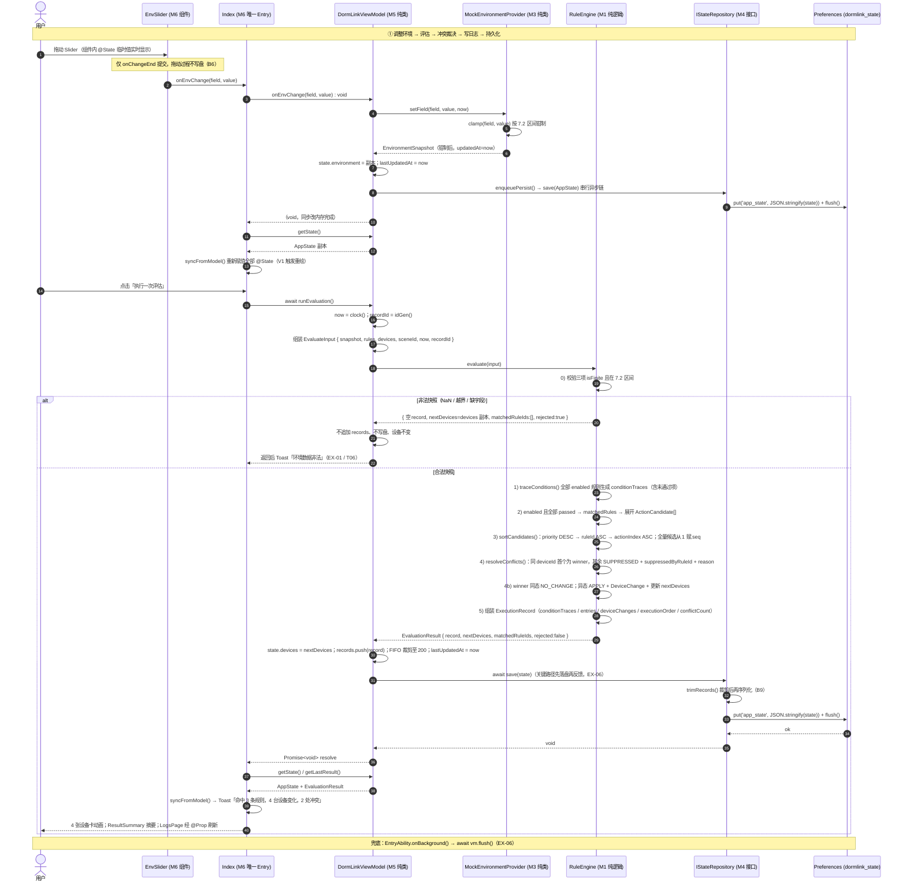
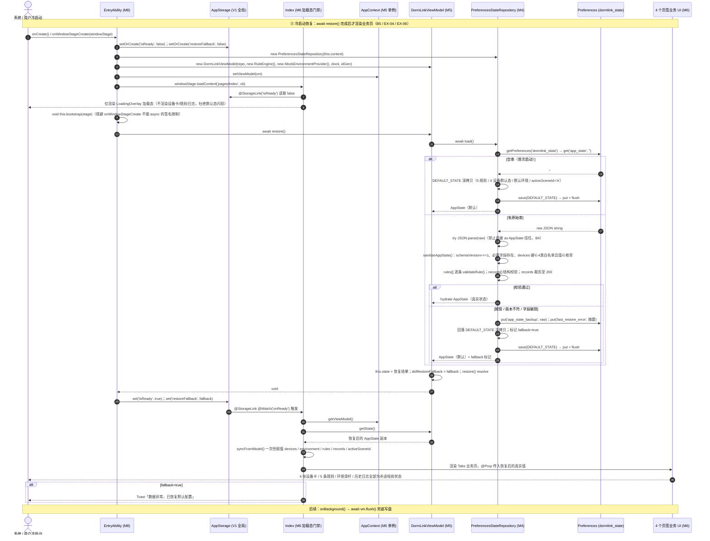
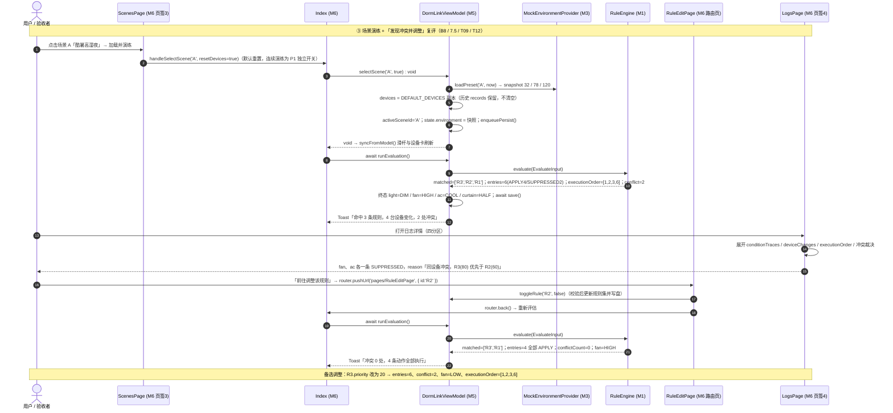
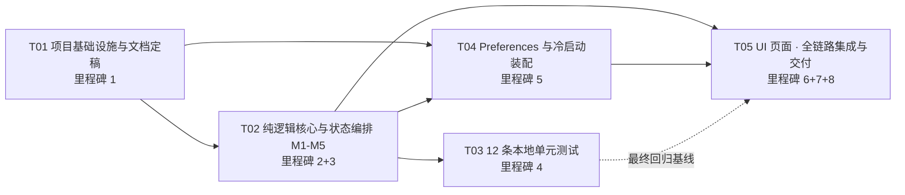

# 《栖居联动 DormLink》系统架构设计

> **文档状态**：v1.0 定稿 · 面向工程师 / QA 的**唯一实现输入**
> **撰写人**：高见远（架构师） · **语言**：简体中文
> **上游输入**：`docs/软件需求说明书.md`（许清楚，v1.0 定稿，698 行 / 12 章 + 附录 A、B）
> **工程路径**：`/Users/yushu/DevEcoStudioProjects/MyApplication`（HarmonyOS Stage 模型 Empty Ability）
> **约束声明**：本文严格遵守 PRD 第 **3、5、7、8 章冻结契约**——字段名、枚举值、函数签名、优先级与日志 `seq` 编号规则**逐字不变**；附录 B 的 B1~B10 在第 7 章逐条给出应对。本文不改动 `build-profile.json5` 的 `compatibleSdkVersion 6.1.1(24)` / `targetSdkVersion 26.0.0`，不执行任何 Git 操作（提交由主理人统一安排）。

---

## 目录

| 章 | 内容 |
|---|---|
| 1 | 实现方案与框架选型 |
| 2 | 完整文件列表（M1~M8 / 新增·修改 / 只读核对） |
| 3 | 数据结构与接口（Mermaid 类图 + 冻结契约逐字对照） |
| 4 | 程序调用流程（3 张 Mermaid 时序图） |
| 5 | 依赖包列表 + 任务列表 + 8 次提交里程碑映射 + 依赖图 |
| 6 | 共享知识 / 跨文件约定 |
| 7 | 附录 B · B1~B10 逐条应对策略 |
| 8 | 待明确事项（仅提问，不改冻结契约） |
| 9 | 本文配套产出清单 |

---

## 1. 实现方案与框架选型

### 1.1 核心技术难点

| # | 难点 | 本质 | 架构对策 |
|---|---|---|---|
| D1 | **纯逻辑可测性** | Local Unit Test 运行在无 ArkUI / 无系统 API 的环境；一旦规则引擎间接引入 `@ohos.*`，12 条用例直接编译失败（B1） | 五层分层 + **构造函数注入**：M1/M2/M3/M5 与 M4 的接口/替身均为零系统依赖的纯 ArkTS 类；`@kit.*` 只允许出现在 `StateRepository.ets` / `EntryAbility.ets` / M6 |
| D2 | **冲突裁决确定性** | 多规则写同一设备时必须结果唯一、可解释、可回归（B3） | `PRIORITY_FIRST`：**先排序、再消解、后执行**；`sortCandidates()` 是唯一赋 `seq` 处，`resolveConflicts()` 只读 `seq` 不重排；禁止后写覆盖 |
| D3 | **冷启动竞态** | Preferences `getPreferences/get` 为异步；UI 先渲染默认态再 hydrate 会跳变、甚至把默认态覆盖写回（B5） | `AppStorage.isReady` 门禁：先 `loadContent('pages/Index')` 显示纯加载态 → `await restore()` → 置 `isReady=true` → `@Watch` 触发一次性 `syncFromModel()` 后才渲染业务页 |
| D4 | **持久化健壮性** | 单文件整体读写，损坏/版本不符/未知设备 id 会导致黑屏；`records` 无限增长（EX-04/EX-05） | `IStateRepository` 隔离 + `sanitizeAppState()` 逐字段白名单校验 + 原串写 `app_state_backup` + 回落 `DEFAULT_STATE` + 200 条 FIFO 裁剪 |
| D5 | **ArkTS 静态类型** | 禁 `any`、`JSON.parse` 不可信任、`Map` 不便序列化、对象展开受限（B4） | 全量显式 `interface` + `Record<string,string>` + 显式字面量重建对象；状态枚举用字符串联合类型而非 `enum` |
| D6 | **状态刷新一致性** | V1/V2 混用刷新异常；深层属性变更 V1 观测不到（B7） | 统一 **V1**（`@State/@Prop/@StorageLink/@Watch`）；ViewModel 为**无装饰器纯类**，`Index` 持有全部 `@State` 镜像，每次事件后**整体重新赋值**（新对象引用） |
| D7 | **高频写盘卡顿** | Slider 拖动每次 `onChange` 都序列化全量 JSON（B6） | 仅 `onChangeEnd` 提交；ViewModel 内部 `pendingSave` 串行 Promise 链合并写盘；评估路径 `await save()` 后再反馈 |
| D8 | **场景可复现** | 是否重置设备直接改变 `NO_CHANGE`/`APPLY` 计数（B8） | `selectScene(sceneId, resetDevices)` 默认 `resetDevices=true`；`PRESET_SCENES` 只含环境三项，不含设备态；「连续演练」是 UI 层 P1 独立开关，只改变实参 |
| D9 | **工程一致性** | 「能编译但页面/测试不生效」（B10） | 单 `@Entry` 宿主 + `Tabs` 显式 import 4 视图；`main_pages.json` 登记所有 `router.pushUrl` 目标；`List.test.ets` 注册全部新套件 |

### 1.2 框架与库选型

| 层 | 选型 | 理由 |
|---|---|---|
| UI 框架 | **ArkUI 声明式开发范式（Stage 模型）**，`@Component` + `build()` | 作业指定 HarmonyOS / ArkTS；声明式 UI 与 `@State` 驱动重绘天然契合「环境变化 → 4 设备卡同步刷新」 |
| 状态管理 | **统一 V1**：`@State` / `@Prop` / `@StorageLink` / `@Watch` | 与模板 `Index.ets` 的 `@State` 写法一致；`@StorageLink` 用于跨 `EntryAbility`→页面的 `isReady` 门禁；V1 API 在 API 24/26 双版本下均稳定（B2/B7） |
| 导航 | **单 `@Entry` `Index` + `Tabs` / `TabContent` 承载 4 页签**；编辑/详情用 `router.pushUrl` 到 2 个 `@Entry` 路由页 | 4 页签共享同一份已恢复状态，避免 4 次 `restore()`；仅 2 个真正需要跨页传参的深页面走路由，最小化路由面 |
| 持久化 | **`@ohos.data.preferences`（经 `@kit.ArkData`）**，实例名 `dormlink_state`，主键 `app_state` | 单一文档（4 设备 + 3 环境 + 5 规则 + ≤200 日志），无联表/事务/条件查询；`put + flush` + `JSON.stringify` 即可；极易被 `IStateRepository` 接口替换（PRD 8.1） |
| 测试 | **`@ohos/hypium` Local Unit Test（`entry/src/test/`）** | 模板已内置 `1.0.25`，写法 `describe/it(name, 0, fn)/expect`；纯逻辑模块可直接 import，无需设备/模拟器 |
| 依赖管理 | **零新增第三方包**，`ohpm install` 不需要 | `oh-package.json5` 已含 `@ohos/hypium`、`@ohos/hamock`；其余全部为 SDK 内置 Kit，无需 ohpm 依赖 |
| 日志 | `@kit.PerformanceAnalysisKit` 的 `hilog`（模板已有） | 仅 M8 / M6 调试用，纯逻辑层禁用 |

**为何不用状态管理 V2**（`@ComponentV2 / @Local / @Param / @Event / @Provider / @Consumer`）：
1. V2 与模板 `Index.ets` 的 V1 `@State` 不能混用，混入会触发刷新异常，直接踩 B7；
2. V2 装饰器在 `compatibleSdkVersion 6.1.1(24)` 下的可用性与行为需额外核对 API 版本表，会带来 B2 兼容风险，而本作品**不需要** V2 的深层观测/精准刷新能力；
3. 本设计用「ViewModel 纯类 + 页面 `@State` 整体重赋值」把状态收敛到单一数据源，V1 的一级观测已足够；
4. 统一 V1 使 `assembleHap` 与模拟器行为可预期，评分项「正确使用组件与状态管理」证据最干净。

**为何不用 RDB**：单文档数据、无联表/事务/分页查询需求；RDB 需建表、SQL、版本迁移与结果集映射，且会把数据结构耦合进 SQL 层、削弱纯逻辑可测性（PRD 8.1 已定稿）。本期固定 `PRIORITY_FIRST` + Preferences；`LAST_WRITE_WINS`、RDB 迁移、`records` 分页均列 P2。

**为何不用 `Navigation` 作为主框架**：`Navigation` + `NavPathStack` 更现代化但复杂度更高（路由表、NavDestination 生命周期、跨页状态共享），对 4 页签的本地模拟型 App 属于过度设计；`Tabs` 单入口 + 2 个 `router` 深页面是最小可用集。

### 1.3 架构模式与分层

采用 **MVVM + 分层架构 + Repository 模式 + 构造函数依赖注入 + 单一数据源（SSOT）**：

```
┌─────────────────────────────────────────────────────────────┐
│ M6 UI（ArkUI V1，仅此层含装饰器 / ArkUI 组件 / promptAction）  │
│   Index(@Entry, Tabs, 加载态门禁, @State 镜像)                 │
│   DashboardPage / RulesPage / ScenesPage / LogsPage（@Component）│
│   RuleEditPage / LogDetailPage（@Entry 路由页）                 │
│   components/*（DeviceCard / EnvSlider / RuleRow / ...）        │
└───────────────▲──────────────────────┬──────────────────────┘
                │ 事件（回调 props）     │ 状态（@Prop 下行）
                │                      ▼
┌───────────────┴──────────────────────────────────────────────┐
│ M5 ViewModel（纯 ArkTS 类，零装饰器、零系统依赖）              │
│   DormLinkViewModel：持有唯一 AppState、编排、串行落盘、恢复     │
│   AppContext：模块级单例 holder（供路由深页面复用同一 VM）      │
└───────▲───────────────────────┬──────────────────────┬───────┘
        │ EvaluateInput          │ AppState             │ 注入
        ▼                       ▼                      ▼
┌───────────────┐  ┌──────────────────────┐  ┌────────────────────┐
│ M1 RuleEngine │  │ M2 Models & Catalog  │  │ M3 MockEnvironment  │
│ 纯逻辑 零系统 │◄─┤ 类型/目录/预置常量   │  │ Provider 纯内存     │
│ 依赖（B1 红线）│  │（唯一契约源）        │  │ clamp / loadPreset  │
└───────────────┘  └──────────────────────┘  └────────────────────┘
        │
        │ IStateRepository（纯接口，M4）
        ▼
┌──────────────────────────────┐   ┌──────────────────────────────┐
│ PreferencesStateRepository   │   │ InMemoryStateRepository      │
│ （唯一 @kit.ArkData 依赖）    │   │ （纯测试替身，零系统依赖）    │
└──────────────┬───────────────┘   └──────────────────────────────┘
               ▼
        @ohos.data.preferences（dormlink_state）

M7 单测（entry/src/test/）→ 只 import M1/M2/M3/M4接口+替身/M5，全部纯 ArkTS
M8 入口（EntryAbility）→ 装配 context 依赖 + await restore() + onBackground flush()
```

**分层红线（B1，硬性）**：

| 层 | 允许 import | 禁止 |
|---|---|---|
| M1 / M2 / M3 / M5（`viewmodel/`）、`IStateRepository.ets`、`InMemoryStateRepository.ets`、`AppContext.ets` | 仅本工程 `engine/` `data/` `viewmodel/` 之间相对路径 | 任何 `@ohos.*` / `@kit.*`；`Date.now()` / 随机数（**`RuleEngine.ets` 尤其禁止**）；`hilog` / `promptAction`；任何装饰器（含 `@Observed` / `@State`） |
| `StateRepository.ets` | `@kit.ArkData` preferences | 被纯逻辑层反向 import |
| M6 页面/组件、M8 `EntryAbility.ets` | ArkUI 组件、`@kit.ArkUI` / `@kit.AbilityKit` / `@kit.PerformanceAnalysisKit` | 直接读写 Preferences（必须经 M4 接口注入） |

> **关键架构决策 AD-01（M4 拆分）**：PRD 5.1 建议把「接口 + Preferences 实现 + 内存替身」放进同一个 `StateRepository.ets`。若照做，`InMemoryStateRepository` 与 `IStateRepository` 会被间接 `@kit.ArkData` 污染，Local Unit Test 一 import 就踩 B1。故**拆为 3 个文件**：`IStateRepository.ets`（纯接口 + 纯校验函数）、`StateRepository.ets`（系统实现）、`InMemoryStateRepository.ets`（纯替身）。**M4 的 4 个函数签名与 5.2 冻结契约逐字一致，仅文件组织细化**，见第 8 章 Q1。

> **关键架构决策 AD-02（M5 无装饰器）**：PRD 3.3 流程图标注「M5 ViewModel `@State`」。为使 T06 / T10 能用 `InMemoryStateRepository` 直接构造并断言 ViewModel 行为，且统一 V1（B7），本设计让 **M5 为无装饰器纯类**，`@State` / `@StorageLink` 全部归属 M6 `Index`。**5.2 的所有方法签名不变**，见第 8 章 Q2。

> **关键架构决策 AD-03（`void` 签名与 `await save()` 的调和）**：5.2 冻结 `onEnvChange / saveRule / deleteRule / toggleRule / selectScene` 返回 `void`，而 8.3 / EX-06 要求「校验通过后立即 `await save()`」「评估路径 `await` 后再反馈」。实现为：这些 `void` 方法**同步改内存 + 投递到 `pendingSave` 串行 Promise 链**（fire-and-forget，不抛未捕获异常），另**新增** `flush(): Promise<void>` 供 `onBackground` / `aboutToDisappear` 兜底 `await`；`runEvaluation / restore / clearRecords` 保持 `Promise<void>` 并 `await save()` 后再返回。新增方法不改变任何冻结签名，见第 8 章 Q3。

> **关键架构决策 AD-04（页面与路由）**：4 个页签以 `@Component` 挂载在唯一 `@Entry` `Index` 的 `Tabs` 中（共享同一份已恢复状态，避免多次 restore）；`main_pages.json` 另外登记 2 个真正需要 `router.pushUrl` 的 `@Entry` 深页面（`RuleEditPage` / `LogDetailPage`），满足 B10「新增页面须登记」。见第 8 章 Q4。

---

## 2. 完整文件列表

> 路径均相对工程根 `/Users/yushu/DevEcoStudioProjects/MyApplication`。
> **新增 30 个 / 修改 8 个 = 需工程师实际创建或编辑 38 个**；**只读核对或保留不改 13 个**；合计 **51 个文件**被纳入本设计清单（另 `README.md` 计入 T01 交付物，不占源码清单编号）。

### 2.1 表 A · 需新增 / 修改的文件（38 个）

| # | 相对路径 | 模块 | 状态 | 职责 |
|---|---|---|---|---|
| **A-1 纯逻辑核心 M1–M3（3）** |||||
| 1 | `entry/src/main/ets/engine/Models.ets` | M2 | 新增 | **唯一冻结契约源**：E1~E11 全部 `interface`/`type`；`ActionCandidate` / `ValidationResult` / `EnvField` / `CompareOp` / `LogStatus` / `DeviceId`；设备与环境目录 `DEVICE_CATALOG` / `ENV_CATALOG`；`DEFAULT_DEVICES` / `DEFAULT_ENVIRONMENT` / `DEFAULT_RULES`(5 条) / `PRESET_SCENES`(3 组) / `DEFAULT_STATE`；常量 `SCHEMA_VERSION=1`、`MAX_RECORDS=200`、`STORAGE_NAME='dormlink_state'`、`STORAGE_KEY='app_state'`、`STORAGE_BACKUP_KEY='app_state_backup'`。**零 `@ohos.*`** |
| 2 | `entry/src/main/ets/engine/RuleEngine.ets` | M1 | 新增 | `RuleEngine` 类：`evaluate / compareCondition / traceConditions / sortCandidates / resolveConflicts / validateRule`；实现 7.4 `PRIORITY_FIRST` 伪代码。**零 `@ohos.*`、零时间/随机数、纯函数不改入参**（B1/B3） |
| 3 | `entry/src/main/ets/engine/MockEnvironmentProvider.ets` | M3 | 新增 | 纯内存环境快照；`getSnapshot / setField / clamp / loadPreset / reset`；`clamp` 按 7.2 区间；构造函数可注入初始快照。**零 `@ohos.*`** |
| **A-2 数据层 M4（3）** |||||
| 4 | `entry/src/main/ets/data/IStateRepository.ets` | M4 | 新增 | **纯**：`IStateRepository` 接口（`load / save / clearRecords / readBackup`）+ `sanitizeAppState(raw): SanitizeResult` 与 `trimRecords()` 纯校验/裁剪函数（供两个实现共用，保证恢复逻辑可单测） |
| 5 | `entry/src/main/ets/data/StateRepository.ets` | M4 | 新增 | **系统层**：`PreferencesStateRepository`（`context` 构造函数注入）；`@kit.ArkData` preferences 的 `getPreferences / get / put / flush`；损坏回落写 `app_state_backup` 与 `last_restore_error`。**全工程唯一持久化 Kit 依赖** |
| 6 | `entry/src/main/ets/data/InMemoryStateRepository.ets` | M4 | 新增 | **纯测试替身**：内存字符串存储 + `seedCorrupt(raw)` 注入损坏串（T08）+ `readBackup()`；与生产实现共用 `sanitizeAppState()`，保证「回落逻辑」被真实测试覆盖 |
| **A-3 状态编排 M5（2）** |||||
| 7 | `entry/src/main/ets/viewmodel/DormLinkViewModel.ets` | M5 | 新增 | **无装饰器纯类**：持有唯一 `AppState`；5.2 的 8 个方法原签名；`pendingSave` 串行落盘链；`clock` / `idGen` 可注入（测试确定性）；`rejected=true` 时不追加日志/不写盘；`getState / getLastResult / didRestoreFallback / flush / setManualDevice`（P1）附加方法 |
| 8 | `entry/src/main/ets/viewmodel/AppContext.ets` | M5 | 新增 | 模块级单例 holder：`setViewModel / getViewModel`，保证 2 个路由深页面复用同一 VM、不二次 `restore()`（B5） |
| **A-4 UI 页面 M6（7）** |||||
| 9 | `entry/src/main/ets/pages/Index.ets` | M6 | **修改** | 唯一 `@Entry` 宿主：`@StorageLink('isReady')+@Watch` 加载态门禁；全量 `@State` 镜像；`syncFromModel()`；`Tabs` 4 页签；事件编排；全局 Toast。替换模板 HelloWorld |
| 10 | `entry/src/main/ets/pages/DashboardPage.ets` | M6 | 新增 | ① 联动看板：2×2 设备卡、3 条环境 Slider、「执行一次评估」主按钮、本轮结果摘要条；P1 手动控制入口 |
| 11 | `entry/src/main/ets/pages/RulesPage.ets` | M6 | 新增 | ② 规则编排：规则列表（条件表达式/动作摘要/优先级徽标/启停 Switch/竞争标注）+「新增规则」→ 路由到 `RuleEditPage` |
| 12 | `entry/src/main/ets/pages/ScenesPage.ets` | M6 | 新增 | ③ 场景演练：3 张预设卡 +「加载并演练」（默认 `resetDevices=true`）+ P1「连续演练」独立开关 |
| 13 | `entry/src/main/ets/pages/LogsPage.ets` | M6 | 新增 | ④ 执行日志：记录列表 + 清空记录 + 详情入口（路由 `LogDetailPage`） |
| 14 | `entry/src/main/ets/pages/RuleEditPage.ets` | M6 | 新增 | `@Entry` 路由页：规则新增/编辑表单，条件行（字段/运算符/阈值，可增删形成 AND）、动作行、优先级输入；`validateRule()` 字段级红字；保存后 `router.back()` |
| 15 | `entry/src/main/ets/pages/LogDetailPage.ets` | M6 | 新增 | `@Entry` 路由页：详情四分区（触发条件 / 设备变化 / 执行顺序 / 冲突裁决）；冲突条目高亮；「前往调整该规则」跳 `RuleEditPage` |
| **A-5 UI 共享组件 M6（6）** |||||
| 16 | `entry/src/main/ets/components/DeviceCard.ets` | M6 | 新增 | 设备状态卡：图标 + 中文名 + 状态彩色标签（关灰/运行绿/冲突橙）+ 状态切换动画 + P1 手动控制 |
| 17 | `entry/src/main/ets/components/EnvSlider.ets` | M6 | 新增 | 环境滑杆：组件内 `@State` 临时值实时显示，**仅 `onChangeEnd` 提交**；`min/max/step` 从 `ENV_CATALOG` 读取（1 / 1 / 50） |
| 18 | `entry/src/main/ets/components/RuleRow.ets` | M6 | 新增 | 规则列表行：条件表达式、动作摘要、优先级徽标、启停 Switch、冲突竞争标注 |
| 19 | `entry/src/main/ets/components/LogRow.ets` | M6 | 新增 | 记录行：时间、场景、命中数、设备变化数、冲突数 |
| 20 | `entry/src/main/ets/components/ResultSummary.ets` | M6 | 新增 | 本轮结果摘要条（「命中 3 条规则，4 台设备变化，2 处冲突」）+「本轮无规则触发」空态 |
| 21 | `entry/src/main/ets/components/Feedback.ets` | M6 | 新增 | 全局 `LoadingOverlay` + `showToast(msg)` 封装（`promptAction.showToast`）+ 状态色/状态文案映射 |
| **A-6 单元测试 M7（6）** |||||
| 22 | `entry/src/test/List.test.ets` | M7 | **修改** | 保留模板调用，**import 并注册 5 个新套件**（见 2.3） |
| 23 | `entry/src/test/RuleEngine.test.ets` | M7 | 新增 | T01 / T02 / T03 / T04 / T05 / T09 / T12（7 条）：冲突裁决、双条件 AND、无命中、临界值、停用规则、调整优先级 |
| 24 | `entry/src/test/MockEnvironment.test.ets` | M7 | 新增 | T06：越界钳制（45/0/95/0）+ `NaN` 快照 `rejected=true` + ViewModel 不追加日志/不写盘 |
| 25 | `entry/src/test/RuleValidation.test.ets` | M7 | 新增 | T07：6 组非法规则全拒 + `DEFAULT_RULES` 整体 `valid=true` |
| 26 | `entry/src/test/Persistence.test.ets` | M7 | 新增 | T08（损坏串 / `schemaVersion=999` 回落 + `readBackup()`）、T11（save→新实例 load 四项深比较一致） |
| 27 | `entry/src/test/RecordsCap.test.ets` | M7 | 新增 | T10：205 次 `evaluate()`（注入递增 `clock`）→ `records.length===200` FIFO，最早 5 条淘汰 |
| **A-7 应用入口 M8（1）** |||||
| 28 | `entry/src/main/ets/entryability/EntryAbility.ets` | M8 | **修改** | 装配 `PreferencesStateRepository(context)` / `RuleEngine` / `MockEnvironmentProvider` / `DormLinkViewModel`；`AppStorage` 门禁；`void bootstrap()` 中 `await restore()`；`onBackground` → `await vm.flush()`；保留原 `hilog` / `setColorMode` |
| **A-8 配置与资源（5）** |||||
| 29 | `entry/src/main/resources/base/profile/main_pages.json` | M6 | **修改** | 登记 `pages/Index`、`pages/RuleEditPage`、`pages/LogDetailPage`（见 2.3） |
| 30 | `entry/src/main/resources/base/element/string.json` | M6 | 修改 | 4 个页签名、页面标题、Toast 与空态中文文案 |
| 31 | `entry/src/main/resources/base/element/color.json` | M6 | 修改 | 状态色资源（灰 / 绿 / 橙）+ 冲突高亮色 |
| 32 | `entry/src/main/resources/base/element/float.json` | M6 | 修改 | 卡标题 / 状态标签字号（保留原 `page_text_font_size`） |
| 33 | `AppScope/resources/base/element/string.json` | M8 | 修改 | `app_name` → `栖居联动` |
| **A-9 文档与交付（5）** |||||
| 34 | `docs/系统架构设计.md` | 交付 | 新增 | 本文（目标二「架构与模块设计 8 分」主素材） |
| 35 | `docs/class-diagram.mermaid` | 交付 | 新增 | 第 3.1 节类图独立文件 |
| 36 | `docs/sequence-diagram.mermaid` | 交付 | 新增 | 时序图 ① 独立文件 |
| 37 | `docs/sequence-diagram-restore.mermaid` | 交付 | 新增 | 时序图 ② 独立文件 |
| 38 | `docs/sequence-diagram-scene.mermaid` | 交付 | 新增 | 时序图 ③ 独立文件 |

> 另需 `README.md`（目标一 / 交付物清单，PRD 11.1 第 1 次提交产物）由主理人/文档环节创建，归入 T01 交付物。

### 2.2 表 B · 只读核对 / 保留不改（13 个，**禁止误改**）

| # | 相对路径 | 模块 | 状态 | 说明 |
|---|---|---|---|---|
| 1 | `build-profile.json5` | M8 | **只读·禁改** | `targetSdkVersion 26.0.0` / `compatibleSdkVersion 6.1.1(24)`（B2 / 强约束） |
| 2 | `entry/build-profile.json5` | M8 | 只读核对 | `apiType: stageMode`、`targets: default / ohosTest` 保持 |
| 3 | `oh-package.json5` | M8 | 不修改 | `modelVersion 26.0.0`；`@ohos/hypium 1.0.25`、`@ohos/hamock 1.0.0` 已在 devDependencies，**零新增第三方依赖** |
| 4 | `entry/oh-package.json5` | M8 | 不修改 | `"dependencies": {}` 保持空 |
| 5 | `entry/src/main/module.json5` | M8 | 只读核对 | `mainElement: EntryAbility`、`pages: $profile:main_pages`；`EntryBackupAbility` 保持 |
| 6 | `AppScope/app.json5` | M8 | 只读核对 | `bundleName: com.example.myapplication`（`aa start -b` 依赖此值，勿改） |
| 7 | `entry/src/mock/mock-config.json5` | M8 | 保留不改 | 空 `{}` 保持 |
| 8 | `entry/src/test/LocalUnit.test.ets` | M7 | **保留不改** | 模板套件保留（PRD 9.1「模板保留」） |
| 9 | `entry/src/ohosTest/ets/test/List.test.ets` | M7 | 保留不改 | 仪器化测试保留模板，本期不作主要证据 |
| 10 | `entry/src/ohosTest/ets/test/Ability.test.ets` | M7 | 保留不改 | 同上 |
| 11 | `entry/src/main/ets/entrybackupability/EntryBackupAbility.ets` | M8 | 保留不改 | 模板备份扩展能力 |
| 12 | `.gitignore` | M8 | 不修改 | 已排除 `oh_modules` / `.hvigor` / `local.properties` / `**/build` |
| 13 | `docs/软件需求说明书.md` | 交付 | **冻结·不改** | 第 3/5/7/8 章契约源；任何契约变更须先回写本文并同步第 9 章（B3） |

### 2.3 关键配置文件的**落盘内容**（工程师照抄）

**`entry/src/main/resources/base/profile/main_pages.json`**（B10：登记所有 `router.pushUrl` 目标）

```json5
{
  "src": [
    "pages/Index",
    "pages/RuleEditPage",
    "pages/LogDetailPage"
  ]
}
```

> 4 个页签 `DashboardPage / RulesPage / ScenesPage / LogsPage` 是 `@Component` 子组件，由 `Index` 显式 `import` 后放入 `Tabs` 的 `TabContent`，**不登记为路由页**（登记了反而因缺 `@Entry` 与独立 `restore()` 而报错）。这是 B10「页面不生效」风险的根本规避。

**`entry/src/test/List.test.ets`**（B10：注册全部新套件）

```typescript
import localUnitTest from './LocalUnit.test';
import ruleEngineTest from './RuleEngine.test';
import mockEnvironmentTest from './MockEnvironment.test';
import ruleValidationTest from './RuleValidation.test';
import persistenceTest from './Persistence.test';
import recordsCapTest from './RecordsCap.test';

export default function testsuite() {
  localUnitTest();
  ruleEngineTest();
  mockEnvironmentTest();
  ruleValidationTest();
  persistenceTest();
  recordsCapTest();
}
```

**12 条用例 → 5 个套件分布**（正常 6 / 边界 4 / 异常 2）

| 套件文件 | 用例 | 分类 |
|---|---|---|
| `RuleEngine.test.ets` | T01, T02, T03, T09, T12（正常 5）+ T04, T05（边界 2） | 7 条 |
| `MockEnvironment.test.ets` | T06（边界 1） | 1 条 |
| `RuleValidation.test.ets` | T07（异常 1） | 1 条 |
| `Persistence.test.ets` | T11（正常 1）+ T08（异常 1） | 2 条 |
| `RecordsCap.test.ets` | T10（边界 1） | 1 条 |
| **合计** | 正常 T01/T02/T03/T09/T11/T12 = 6；边界 T04/T05/T06/T10 = 4；异常 T07/T08 = 2 | **12 条** |

**`build-profile.json5`**：只读核对，两项 SDK 版本**任何任务都不得触碰**。

---

## 3. 数据结构与接口

### 3.1 Mermaid 类图（字段名与函数签名对齐 PRD 第 3 / 5 / 8 章）

```mermaid
classDiagram
direction TB

class EnvironmentSnapshot {
  <<interface E1 pure>>
  +temperature : number
  +humidity : number
  +illuminance : number
  +updatedAt : number
}
class DeviceStateMap {
  <<type E2 = Record~string,string~>>
  +light : string
  +fan : string
  +ac : string
  +curtain : string
}
class Condition {
  <<interface E4 pure>>
  +field : EnvField
  +op : CompareOp
  +threshold : number
}
class RuleAction {
  <<interface E5 pure>>
  +deviceId : string
  +targetState : string
}
class Rule {
  <<interface E3 pure>>
  +id : string
  +name : string
  +enabled : boolean
  +priority : number
  +logic : string
  +conditions : Condition[]
  +actions : RuleAction[]
  +createdAt : number
  +updatedAt : number
}
class ConditionTrace {
  <<interface E6 pure>>
  +ruleId : string
  +field : string
  +op : string
  +threshold : number
  +actual : number
  +passed : boolean
}
class LogEntry {
  <<interface E7 pure>>
  +seq : number
  +ruleId : string
  +ruleName : string
  +priority : number
  +actionIndex : number
  +deviceId : string
  +targetState : string
  +fromState : string
  +toState : string
  +status : LogStatus
  +suppressedByRuleId : string
  +reason : string
}
class DeviceChange {
  <<interface E8 pure>>
  +deviceId : string
  +fromState : string
  +toState : string
  +ruleId : string
  +seq : number
}
class ExecutionRecord {
  <<interface E9 pure>>
  +id : string
  +timestamp : number
  +sceneId : string
  +snapshot : EnvironmentSnapshot
  +matchedRuleIds : string[]
  +conditionTraces : ConditionTrace[]
  +entries : LogEntry[]
  +deviceChanges : DeviceChange[]
  +executionOrder : number[]
  +conflictCount : number
}
class AppState {
  <<interface E10 pure>>
  +schemaVersion : number
  +devices : DeviceStateMap
  +environment : EnvironmentSnapshot
  +rules : Rule[]
  +records : ExecutionRecord[]
  +activeSceneId : string
  +lastUpdatedAt : number
}
class EvaluateInput {
  <<interface E11 pure>>
  +snapshot : EnvironmentSnapshot
  +rules : Rule[]
  +devices : DeviceStateMap
  +sceneId : string
  +now : number
  +recordId : string
}
class EvaluationResult {
  <<interface E11 pure>>
  +record : ExecutionRecord
  +nextDevices : DeviceStateMap
  +matchedRuleIds : string[]
  +rejected : boolean
}
class ActionCandidate {
  <<internal 7.4 pure>>
  +ruleId : string
  +ruleName : string
  +priority : number
  +actionIndex : number
  +deviceId : string
  +targetState : string
  +seq : number
}
class ValidationResult {
  <<interface 5.2 pure>>
  +valid : boolean
  +errors : string[]
}

class RuleEngine {
  <<M1 pure 零系统依赖 零装饰器>>
  +evaluate(input: EvaluateInput) EvaluationResult
  +compareCondition(c: Condition, snapshot: EnvironmentSnapshot) boolean
  +traceConditions(rule: Rule, snapshot: EnvironmentSnapshot) ConditionTrace[]
  +sortCandidates(candidates: ActionCandidate[]) ActionCandidate[]
  +resolveConflicts(sorted: ActionCandidate[], devices: DeviceStateMap) LogEntry[]
  +validateRule(rule: Rule) ValidationResult
}
class Models {
  <<M2 pure 单一契约源>>
  +DEVICE_CATALOG : DeviceCatalog
  +ENV_CATALOG : EnvCatalog
  +DEFAULT_DEVICES : DeviceStateMap
  +DEFAULT_ENVIRONMENT : EnvironmentSnapshot
  +DEFAULT_RULES : Rule[]
  +PRESET_SCENES : PresetScene[]
  +DEFAULT_STATE : AppState
  +SCHEMA_VERSION : number
  +MAX_RECORDS : number
  +STORAGE_NAME : string
  +STORAGE_KEY : string
  +STORAGE_BACKUP_KEY : string
}
class MockEnvironmentProvider {
  <<M3 pure 可注入>>
  -snapshot : EnvironmentSnapshot
  +getSnapshot() EnvironmentSnapshot
  +setField(field: EnvField, value: number, now: number) EnvironmentSnapshot
  +clamp(field: EnvField, value: number) number
  +loadPreset(sceneId: string, now: number) EnvironmentSnapshot
  +reset(now: number) EnvironmentSnapshot
}
class IStateRepository {
  <<M4 interface pure>>
  +load() Promise~AppState~
  +save(state: AppState) Promise~void~
  +clearRecords() Promise~void~
  +readBackup() Promise~string~
}
class PreferencesStateRepository {
  <<M4 system 唯一 Kit 依赖>>
  -context : Context
  -preferencesName : string
  +constructor(context: Context)
  +load() Promise~AppState~
  +save(state: AppState) Promise~void~
  +clearRecords() Promise~void~
  +readBackup() Promise~string~
  -sanitize(raw: string) SanitizeResult
}
class InMemoryStateRepository {
  <<M4 pure 测试替身>>
  -stored : string
  -backup : string
  +seedCorrupt(raw: string) void
  +load() Promise~AppState~
  +save(state: AppState) Promise~void~
  +clearRecords() Promise~void~
  +readBackup() Promise~string~
}
class DormLinkViewModel {
  <<M5 pure 无装饰器>>
  -state : AppState
  -repo : IStateRepository
  -engine : RuleEngine
  -env : MockEnvironmentProvider
  -clock : function
  -idGen : function
  -pendingSave : Promise~void~
  +constructor(repo: IStateRepository, engine: RuleEngine, env: MockEnvironmentProvider, clock: function, idGen: function)
  +restore() Promise~void~
  +onEnvChange(field: EnvField, value: number) void
  +runEvaluation() Promise~void~
  +saveRule(rule: Rule) void
  +deleteRule(id: string) void
  +toggleRule(id: string, enabled: boolean) void
  +selectScene(sceneId: string, resetDevices: boolean) void
  +clearRecords() Promise~void~
  +getState() AppState
  +getLastResult() EvaluationResult
  +didRestoreFallback() boolean
  +flush() Promise~void~
  +setManualDevice(deviceId: string, targetState: string) void
}
class AppContext {
  <<M5 pure 模块级单例>>
  -vm : DormLinkViewModel
  +setViewModel(vm: DormLinkViewModel) void
  +getViewModel() DormLinkViewModel
}
class EntryAbility {
  <<M8 system 装配与生命周期>>
  +onCreate(want: Want, launchParam: AbilityConstant.LaunchParam) void
  +onWindowStageCreate(windowStage: window.WindowStage) void
  +onBackground() void
  -bootstrap(stage: window.WindowStage) Promise~void~
}
class Index {
  <<M6 Entry 唯一入口 V1>>
  +isReady : boolean
  +devices : DeviceStateMap
  +environment : EnvironmentSnapshot
  +rules : Rule[]
  +records : ExecutionRecord[]
  +activeSceneId : string
  +lastResult : EvaluationResult
  +currentTabIndex : number
  +syncFromModel() void
  +handleEnvChange(field: EnvField, value: number) void
  +handleEvaluate() Promise~void~
  +handleSelectScene(sceneId: string, reset: boolean) void
}
class DashboardPage {
  <<M6 Component 页签1>>
}
class RulesPage {
  <<M6 Component 页签2>>
}
class ScenesPage {
  <<M6 Component 页签3>>
}
class LogsPage {
  <<M6 Component 页签4>>
}
class RuleEditPage {
  <<M6 Entry 路由页>>
}
class LogDetailPage {
  <<M6 Entry 路由页>>
}
class UiComponents {
  <<M6 Component 共享组件>>
}

Rule "1" *-- "1..*" Condition : conditions
Rule "1" *-- "1..*" RuleAction : actions
ExecutionRecord "1" *-- "1" EnvironmentSnapshot : snapshot 原样留档
ExecutionRecord "1" *-- "1..*" ConditionTrace : conditionTraces
ExecutionRecord "1" *-- "1..*" LogEntry : entries 按 seq 升序
ExecutionRecord "1" *-- "0..*" DeviceChange : deviceChanges 仅 APPLY
AppState "1" *-- "1" DeviceStateMap : devices
AppState "1" *-- "1" EnvironmentSnapshot : environment
AppState "1" *-- "0..*" Rule : rules
AppState "1" *-- "0..200" ExecutionRecord : records FIFO
EvaluateInput "1" --> "1" EnvironmentSnapshot : snapshot
EvaluateInput "1" --> "1" DeviceStateMap : devices
EvaluateInput "1" --> "0..*" Rule : rules
EvaluationResult "1" --> "1" ExecutionRecord : record
EvaluationResult "1" --> "1" DeviceStateMap : nextDevices

RuleEngine ..> Models : 只读常量与类型
RuleEngine ..> EvaluateInput : 入参
RuleEngine ..> EvaluationResult : 出参
RuleEngine ..> ActionCandidate : 展开候选
RuleEngine ..> LogEntry : resolveConflicts 产出
RuleEngine ..> ValidationResult : validateRule 产出
MockEnvironmentProvider ..> Models : ENV_CATALOG / PRESET_SCENES
MockEnvironmentProvider ..> EnvironmentSnapshot : 产出
IStateRepository <|.. PreferencesStateRepository : 实现
IStateRepository <|.. InMemoryStateRepository : 实现 测试替身
PreferencesStateRepository ..> RuleEngine : validateRule 校验恢复规则
InMemoryStateRepository ..> RuleEngine : validateRule 校验恢复规则
DormLinkViewModel o-- IStateRepository : 构造函数注入
DormLinkViewModel o-- RuleEngine : 构造函数注入
DormLinkViewModel o-- MockEnvironmentProvider : 构造函数注入
DormLinkViewModel *-- AppState : 唯一权威状态 SSOT
AppContext o-- DormLinkViewModel : 持有单例
EntryAbility ..> PreferencesStateRepository : new context
EntryAbility ..> DormLinkViewModel : 装配 + await restore
EntryAbility ..> AppContext : setViewModel
Index ..> AppContext : getViewModel
Index *-- DashboardPage : Tabs.TabContent
Index *-- RulesPage : Tabs.TabContent
Index *-- ScenesPage : Tabs.TabContent
Index *-- LogsPage : Tabs.TabContent
DashboardPage ..> UiComponents : DeviceCard / EnvSlider / ResultSummary
RulesPage ..> UiComponents : RuleRow / Feedback
ScenesPage ..> UiComponents : Feedback
LogsPage ..> UiComponents : LogRow / Feedback
RulesPage ..> RuleEditPage : router.pushUrl
LogsPage ..> LogDetailPage : router.pushUrl
LogDetailPage ..> RuleEditPage : 前往调整该规则
RuleEditPage ..> AppContext : getViewModel
LogDetailPage ..> AppContext : getViewModel
```



> 独立文件：`docs/class-diagram.mermaid`

### 3.2 冻结契约逐字对照（ArkTS 声明，工程师直接复制）

> 以下声明的**字段名、类型、枚举值**与 PRD 3.1（E1~E11）、3.2、7.1、7.2、7.3、7.4、8.2 完全一致；`Models.ets` 必须原样落地。

```typescript
// ---------- 基础类型别名 ----------
export type DeviceId = 'light' | 'fan' | 'ac' | 'curtain';
export type EnvField = 'temperature' | 'humidity' | 'illuminance';
export type CompareOp = 'GT' | 'GTE' | 'LT' | 'LTE' | 'EQ';
export type LogStatus = 'APPLY' | 'NO_CHANGE' | 'SUPPRESSED';

// E1
export interface EnvironmentSnapshot {
  temperature: number;
  humidity: number;
  illuminance: number;
  updatedAt: number;
}
// E2
export type DeviceStateMap = Record<string, string>;
// E4 / E5
export interface Condition  { field: EnvField; op: CompareOp; threshold: number; }
export interface RuleAction { deviceId: string; targetState: string; }
// E3
export interface Rule {
  id: string; name: string; enabled: boolean; priority: number;
  logic: string; conditions: Condition[]; actions: RuleAction[];
  createdAt: number; updatedAt: number;
}
// E6
export interface ConditionTrace {
  ruleId: string; field: string; op: string; threshold: number;
  actual: number; passed: boolean;
}
// E7
export interface LogEntry {
  seq: number; ruleId: string; ruleName: string; priority: number;
  actionIndex: number; deviceId: string; targetState: string;
  fromState: string; toState: string; status: LogStatus;
  suppressedByRuleId: string; reason: string;
}
// E8
export interface DeviceChange {
  deviceId: string; fromState: string; toState: string;
  ruleId: string; seq: number;
}
// E9
export interface ExecutionRecord {
  id: string; timestamp: number; sceneId: string;
  snapshot: EnvironmentSnapshot; matchedRuleIds: string[];
  conditionTraces: ConditionTrace[]; entries: LogEntry[];
  deviceChanges: DeviceChange[]; executionOrder: number[];
  conflictCount: number;
}
// E10
export interface AppState {
  schemaVersion: number; devices: DeviceStateMap;
  environment: EnvironmentSnapshot; rules: Rule[];
  records: ExecutionRecord[]; activeSceneId: string;
  lastUpdatedAt: number;
}
// E11
export interface EvaluateInput {
  snapshot: EnvironmentSnapshot; rules: Rule[]; devices: DeviceStateMap;
  sceneId: string; now: number; recordId: string;
}
export interface EvaluationResult {
  record: ExecutionRecord; nextDevices: DeviceStateMap;
  matchedRuleIds: string[]; rejected: boolean;
}
// 7.4 内部候选（seq 由 sortCandidates 从 1 赋值，为内部字段，不进入任何持久化键）
export interface ActionCandidate {
  ruleId: string; ruleName: string; priority: number; actionIndex: number;
  deviceId: string; targetState: string; seq: number;
}
// 5.2
export interface ValidationResult { valid: boolean; errors: string[]; }

// ---------- 常量（8.2 / 7.1 / 7.2） ----------
export const SCHEMA_VERSION: number = 1;
export const MAX_RECORDS: number = 200;
export const STORAGE_NAME: string = 'dormlink_state';
export const STORAGE_KEY: string = 'app_state';
export const STORAGE_BACKUP_KEY: string = 'app_state_backup';
export const STORAGE_ERROR_KEY: string = 'last_restore_error';
```

**冻结函数签名表（PRD 5.2，逐字一致，不得改名/改参/改返回类型）**

| 模块 | 签名 |
|---|---|
| M1 | `evaluate(input: EvaluateInput): EvaluationResult` |
| M1 | `compareCondition(c: Condition, snapshot: EnvironmentSnapshot): boolean` |
| M1 | `traceConditions(rule: Rule, snapshot: EnvironmentSnapshot): ConditionTrace[]` |
| M1 | `sortCandidates(candidates: ActionCandidate[]): ActionCandidate[]` |
| M1 | `resolveConflicts(sorted: ActionCandidate[], devices: DeviceStateMap): LogEntry[]` |
| M1 | `validateRule(rule: Rule): ValidationResult` |
| M3 | `getSnapshot(): EnvironmentSnapshot` |
| M3 | `setField(field: EnvField, value: number, now: number): EnvironmentSnapshot` |
| M3 | `clamp(field: EnvField, value: number): number` |
| M3 | `loadPreset(sceneId: string, now: number): EnvironmentSnapshot` |
| M3 | `reset(now: number): EnvironmentSnapshot` |
| M4 | `load(): Promise<AppState>` / `save(state: AppState): Promise<void>` / `clearRecords(): Promise<void>` / `readBackup(): Promise<string>` |
| M5 | `restore(): Promise<void>` |
| M5 | `onEnvChange(field: EnvField, value: number): void` |
| M5 | `runEvaluation(): Promise<void>` |
| M5 | `saveRule(rule: Rule): void` / `deleteRule(id: string): void` / `toggleRule(id: string, enabled: boolean): void` |
| M5 | `selectScene(sceneId: string, resetDevices: boolean): void` |
| M5 | `clearRecords(): Promise<void>` |

> **附加（非冻结， additive）方法**：`getState(): AppState`、`getLastResult(): EvaluationResult`、`didRestoreFallback(): boolean`、`flush(): Promise<void>`、`setManualDevice(deviceId: string, targetState: string): void`（P1）、`InMemoryStateRepository.seedCorrupt(raw: string): void`、构造函数 `DormLinkViewModel(repo, engine, env, clock?, idGen?)` / `PreferencesStateRepository(context)`。新增方法**不修改任何冻结签名**。

### 3.3 预置常量（PRD 7.1 / 7.2 / 7.3 / 7.5，逐项对齐）

**设备目录 `DEVICE_CATALOG`**

| deviceId | 名称 | states（**默认加粗**） | 默认初态 |
|---|---|---|---|
| `light` | 主灯 | OFF / **ON** / DIM → 实际默认 **OFF** | `OFF` |
| `fan` | 排风扇 | **OFF** / LOW / HIGH | `OFF` |
| `ac` | 空调 | **OFF** / COOL / HEAT | `OFF` |
| `curtain` | 智能窗帘 | **CLOSED** / HALF / OPEN | `CLOSED` |

> `DEFAULT_DEVICES = { light:'OFF', fan:'OFF', ac:'OFF', curtain:'CLOSED' }`；UI 动作名（`TURN_ON→ON`、`SET_LOW→LOW`、`SET_OPEN→OPEN` 等）只做 P1 手动控制文案映射，**不进入 `RuleAction.targetState`**。

**环境目录 `ENV_CATALOG`**

| field | 名称 | 单位 | min | max | default | step |
|---|---|---|---|---|---|---|
| `temperature` | 室内温度 | ℃ | 0 | 45 | 26 | 1 |
| `humidity` | 室内湿度 | %RH | 10 | 95 | 55 | 1 |
| `illuminance` | 光照强度 | lx | 0 | 2000 | 300 | 50 |

> 运算符：`GT >`、`GTE >=`、`LT <`、`LTE <=`、`EQ ==`；**`>=` 含等号、`<` 不含等号**（T05 锁定）。
> `DEFAULT_ENVIRONMENT = { temperature: 26, humidity: 55, illuminance: 300, updatedAt: <首次启动 now> }`。

**`DEFAULT_RULES`（5 条，`logic='AND'`，`enabled=true`）**

| id | name | conditions | actions | priority |
|---|---|---|---|---|
| `R1` | 夜间补光 | `illuminance LT 200` | `light=DIM` | 30 |
| `R2` | 高温制冷 | `temperature GTE 30` | `ac=COOL`, `fan=LOW` | 60 |
| `R3` | 高温高湿强排 | `temperature GTE 28`, `humidity GTE 70` | `ac=COOL`, `fan=HIGH`, `curtain=HALF` | 80 |
| `R4` | 低温暗夜取暖 | `temperature LTE 20`, `illuminance LT 500` | `ac=HEAT`, `light=ON`, `curtain=CLOSED` | 50 |
| `R5` | 日间采光节能 | `illuminance GTE 1000` | `light=OFF`, `curtain=OPEN` | 40 |

**`PRESET_SCENES`（3 组，纯常量，只含环境三项 + 预期说明，不含设备态）**

| sceneId | 名称 | 输入 温/湿/光 | 预期命中 | 预期 entries | 终态 | executionOrder / conflictCount |
|---|---|---|---|---|---|---|
| `A` | 酷暑高湿夜 | `32 / 78 / 120` | `R3,R2,R1` | 6（APPLY4/SUPPRESSED2） | `light=DIM, fan=HIGH, ac=COOL, curtain=HALF` | `[1,2,3,6]` / 2 |
| `B` | 低温暗夜 | `18 / 60 / 100` | `R4,R1` | 4（APPLY2/NO_CHANGE1/SUPPRESSED1） | `light=ON, fan=OFF, ac=HEAT, curtain=CLOSED` | `[1,2]` / 1 |
| `C` | 清朗日间 | `24 / 50 / 1200` | `R5` | 2（APPLY1/NO_CHANGE1） | `light=OFF, fan=OFF, ac=OFF, curtain=OPEN` | `[2]` / 0 |

> `DEFAULT_STATE = { schemaVersion:1, devices:DEFAULT_DEVICES, environment:DEFAULT_ENVIRONMENT, rules:DEFAULT_RULES, records:[], activeSceneId:'A', lastUpdatedAt:<now> }`。
> `sceneId` 取值见第 8 章 Q5；自定义评估固定 `'CUSTOM'`。

### 3.4 冲突裁决契约（PRD 7.4，`RuleEngine.evaluate` 唯一实现）

```
evaluate(input: EvaluateInput): EvaluationResult
  0) 校验 snapshot 三项 Number.isFinite 且在 7.2 区间内
     非法 → { 空 record(entries=[], matchedRuleIds=[], conflictCount=0, conditionTraces=[],
               deviceChanges=[], executionOrder=[]), nextDevices = input.devices 的副本,
               matchedRuleIds: [], rejected: true }   // 不抛异常、不落盘
  1) 对每条 enabled 规则 traceConditions(rule, snapshot) → conditionTraces（含未通过项）
     enabled=true 且全部 passed → matchedRules
  2) 展开 matchedRules 的每个 action → ActionCandidate[]（actionIndex 从 0）
  3) sortCandidates(candidates)
     排序键：priority DESC → ruleId ASC（字典序）→ actionIndex ASC
     对【全量候选，含后续将被 SUPPRESSED / NO_CHANGE 的条目】从 1 连续赋 seq
     matchedRuleIds = 来源规则去重后按 priority DESC → ruleId ASC 排列
  4) resolveConflicts(sorted, input.devices)
     按 seq 升序，每个 deviceId 只保留首个候选为 winner
     其余 → SUPPRESSED + suppressedByRuleId(=winner.ruleId) + reason
     winner：targetState === 当前状态 → NO_CHANGE（toState = fromState，不产生 DeviceChange）
             否则 → APPLY，产生 DeviceChange，更新 nextDevices
  5) 组装 ExecutionRecord { id: input.recordId, timestamp: input.now, sceneId: input.sceneId,
       snapshot: input.snapshot 原样留档, matchedRuleIds, conditionTraces, entries(按 seq 升序),
       deviceChanges(仅 APPLY，与 executionOrder 同序),
       executionOrder: entries.filter(status==='APPLY').map(seq),  // 升序
       conflictCount: entries.filter(status==='SUPPRESSED').length }
  6) return { record, nextDevices, matchedRuleIds, rejected: false }
  约束：不 import 任何 @ohos.*；不调用 Date.now()/随机数；不修改入参；不落盘
```

> **`seq` 红线（B3）**：`sortCandidates()` 是全工程**唯一**赋 `seq` 的地方；`resolveConflicts()` 只读 `seq`，**不重排、不重新编号、不覆盖已写入的 `nextDevices`**。`executionOrder` 与 `deviceChanges` 由 `entries` 派生，禁止用规则数组顺序反推。任何契约变更须先回写 PRD 第 7、9 章并全量回归 12 条。

---

## 4. 程序调用流程

### 4.1 时序图 ①「调整环境 → 评估 → 冲突裁决 → 写日志 → 持久化」



> 独立文件：`docs/sequence-diagram.mermaid`

### 4.2 时序图 ②「冷启动恢复」



> 独立文件：`docs/sequence-diagram-restore.mermaid`

### 4.3 时序图 ③「场景演练 + 发现冲突并调整」



> 独立文件：`docs/sequence-diagram-scene.mermaid`

---

## 5. 依赖包列表 · 任务列表 · 提交里程碑

### 5.1 依赖包列表（**零新增第三方依赖**）

| 包 / 能力 | 版本 / 来源 | 用途 | 是否需 `ohpm install` |
|---|---|---|---|
| `@ohos/hypium` | `1.0.25`，根 `oh-package.json5` devDependencies **已有** | Local Unit Test 框架（`describe/it/expect`） | 否 |
| `@ohos/hamock` | `1.0.0`，根 `oh-package.json5` devDependencies **已有** | 模板保留，本期 Mock 用纯内存常量，不强依赖 | 否 |
| `@kit.ArkData`（`preferences`） | SDK 内置（API ≤24 稳定） | `PreferencesStateRepository` 唯一持久化能力 | 否 |
| `@kit.ArkUI`（`window` / `router` / `promptAction` / ArkUI 组件） | SDK 内置 | 窗口加载、2 个深页面路由、Toast、声明式 UI | 否 |
| `@kit.AbilityKit`（`UIAbility` / `Want` / `AbilityConstant` / `ConfigurationConstant`） | SDK 内置，模板已有 | `EntryAbility` 生命周期 | 否 |
| `@kit.PerformanceAnalysisKit`（`hilog`） | SDK 内置，模板已有 | M8 调试日志 | 否 |

> **结论**：`oh-package.json5` 与 `entry/oh-package.json5` **保持原样**，不执行 `ohpm install`，不引入任何第三方 UI / 网络 / 状态库（PRD 2.5 Out of Scope 第 5 条）。全部能力由模板 + SDK 内置 Kit 提供。这也消除了 B2「API 26 新增能力在 24 上的兼容风险」。

### 5.2 任务列表（T01~T05，按依赖顺序，每组 ≥3 文件）

> **分组原则**：按模块/层次分组，不按单文件拆分；T01 为项目基础设施（配置 + 入口骨架 + 依赖核对 + 文档定稿）；尽量让后续任务只依赖 T01/T02。
> **优先级**：全部 P0（对应 PRD 2.5 Must 范围）。

| 任务 | 名称 | 依赖 | 优先级 | 涉及文件 | 验收点 |
|---|---|---|---|---|---|
| **T01** | **项目基础设施与文档定稿** | — | P0 | `README.md`；`docs/系统架构设计.md`、`docs/class-diagram.mermaid`、`docs/sequence-diagram.mermaid`、`docs/sequence-diagram-restore.mermaid`、`docs/sequence-diagram-scene.mermaid`；`entry/src/main/resources/base/profile/main_pages.json`（登记 3 页）；`entry/.../element/string.json`、`color.json`、`float.json`；`AppScope/resources/base/element/string.json`（app_name）；`entry/src/main/ets/pages/Index.ets`（**加载态骨架**）；`entry/src/main/ets/entryability/EntryAbility.ets`（**装配骨架**）；只读核对 `build-profile.json5`、`entry/build-profile.json5`、`oh-package.json5`、`entry/oh-package.json5`、`entry/src/main/module.json5`、`AppScope/app.json5`、`entry/src/mock/mock-config.json5`、`.gitignore` | ① `assembleHap` 仍 BUILD SUCCESSFUL；② SDK 双版本**逐字未改**；③ `main_pages.json` 恰好 3 条；④ `Index` 仅显示加载态、无任何业务 UI；⑤ 零新增依赖确认；⑥ 架构文档与本文 3 个 mermaid 图一致 |
| **T02** | **纯逻辑核心与状态编排（M1–M5 全部纯 ArkTS）** | T01 | P0 | `engine/Models.ets`、`engine/RuleEngine.ets`、`engine/MockEnvironmentProvider.ets`、`data/IStateRepository.ets`、`data/InMemoryStateRepository.ets`、`viewmodel/DormLinkViewModel.ets`、`viewmodel/AppContext.ets`（共 7 个新增） | ① 7 个文件 Grep `@ohos`/`@kit` **零命中**；② 7 个文件**零装饰器**；③ `RuleEngine.ets` 零 `Date.now`/随机数/入参修改；④ 手工内存验证 7.5 三组场景（A `executionOrder=[1,2,3,6]` / B `[1,2]` / C `[2]`）与「停用 R2」「R3→20」两组调整后预期；⑤ `validateRule` 6 组非法输入全拒、`DEFAULT_RULES` 整体 `valid=true`；⑥ `clamp` 45/0/95/0 正确 |
| **T03** | **12 条 Local Unit Test 与结果留证** | T02 | P0 | `entry/src/test/List.test.ets`（修改注册）、`RuleEngine.test.ets`、`MockEnvironment.test.ets`、`RuleValidation.test.ets`、`Persistence.test.ets`、`RecordsCap.test.ets`（共 6 个） | ① **12/12 PASS**（正常 6 / 边界 4 / 异常 2），DevEco Studio 右键 `entry/src/test/` → Run「Local Unit Test」真实运行；② `List.test.ets` 已 import 并调用 5 个套件；③ 模板 `LocalUnit.test.ets` 保留不改；④ 测试通过截图 + 控制台日志文本归档 `screenshots/` 与 `docs/`；⑤ `ohosTest` 保持模板 |
| **T04** | **Preferences 系统实现与冷启动装配** | T01, T02 | P0 | `data/StateRepository.ets`（新增）、`entryability/EntryAbility.ets`（补全 bootstrap / onBackground flush）、`pages/Index.ets`（补全 `isReady` 门禁 + `syncFromModel()`） | ① `await restore()` 完成前 UI **只显示加载态**，无默认态闪现、无覆盖写回；② 杀进程重启后 `devices / environment / rules / records` 四项逐项一致；③ 注入 `'{bad json'` 与 `schemaVersion=999` 两种损坏串 → 回落 `DEFAULT_STATE` + Toast + `readBackup()` 可取回原串、无崩溃；④ `onBackground` 触发 `await vm.flush()`；⑤ 评估路径 `await save()` 后才反馈；⑥ `assembleHap` 成功 |
| **T05** | **UI 页面 / 组件 · 全链路集成与交付** | T02, T04（T03 结果作最终回归基线） | P0 | `pages/DashboardPage.ets`、`RulesPage.ets`、`ScenesPage.ets`、`LogsPage.ets`、`RuleEditPage.ets`、`LogDetailPage.ets`；`components/DeviceCard.ets`、`EnvSlider.ets`、`RuleRow.ets`、`LogRow.ets`、`ResultSummary.ets`、`Feedback.ets`；`pages/Index.ets`（Tabs 集成）（共 13 个） | ① 底部 4 页签可用、状态色一致（灰/绿/橙）、每次操作有 Toast/动画；② Slider **仅 `onChangeEnd` 提交**，`min/max/step` 与 7.2 一致；③ PRD 第 6 章 8 步链路一次演示通关（含新增规则、场景 A、日志详情、停用 R2、杀进程重启）；④ 场景 A/B/C 与 7.5 精确一致；⑤ 规则页 CRUD/启停/优先级 + 字段级红字校验可用；⑥ 日志详情四分区齐全且「前往调整该规则」可跳；⑦ 最终全量回归 12 条测试；⑧ ≥4 张截图 + 演示录屏 + README + 8 次提交自检；⑨ `assembleHap` + 模拟器 `hdc install` / `aa start` 通过 |

### 5.3 任务 ↔ 8 次提交里程碑映射（PRD 11.2）

| 提交 # | 开发节点 | 建议 commit message | 归属任务 | 该次自检 |
|---|---|---|---|---|
| 1 | 需求 / 架构定稿 | `docs: 新增软件需求说明书与 README 骨架` | **T01** | SDK 版本未改；`assembleHap` 成功 |
| 2 | 模型与预置数据 | `feat(engine): 定义设备/环境/规则模型与预置规则、场景常量` | **T02**（`Models.ets`） | 契约字段与源码一致 |
| 3 | 纯逻辑引擎 | `feat(engine): 实现规则引擎（条件判定、优先级冲突裁决、执行日志）` | **T02**（`RuleEngine.ets` + M3 + M4纯 + M5） | 三组场景内存验证 |
| 4 | 单元测试 | `test(engine): 添加 12 条本地单元测试并全部通过（正常/边界/异常）` | **T03** | 12/12 PASS + 截图归档 |
| 5 | 持久化 | `feat(data): 实现 Preferences 仓储、冷启动恢复与损坏回落` | **T04** | 杀进程恢复 + 损坏回落 |
| 6 | 看板页面 | `feat(ui): 实现设备看板、环境滑杆与一次评估交互` | **T05**（`DashboardPage` + 3 组件） | `assembleHap` + 模拟器 |
| 7 | 规则 / 场景 / 日志 | `feat(ui): 实现规则编辑启停、场景演练与执行日志详情页` | **T05**（余下 3 页 + 2 路由页 + 3 组件） | 场景 A/B/C 精确 |
| 8 | 集成与交付 | `feat(app): 集成全流程与异常兜底；补充架构文档、截图、演示与交付说明` | **T05**（集成/回归/交付） | **全量回归 12 条** + 全部交付物 |

> ⚠️ 提交由**主理人统一安排**，工程师与架构师不执行任何 Git 命令。每次提交自检：① SDK 版本约束未改；② `assembleHap` 仍成功；③ 触及引擎契约则重跑 12 条；④ commit message 与产物一致。

### 5.4 任务依赖图



---

## 6. 共享知识 / 跨文件约定（工程师必读）

| # | 约定 | 说明 |
|---|---|---|
| K01 | **冻结契约单一落点** | `Models.ets` 是 E1~E11、目录、5 规则、3 场景、默认态的**唯一**定义处；`RuleEngine.ets` 是 `seq`/裁决的**唯一**实现处。字段名、枚举、签名与 PRD 3/5/7/8 章逐字一致；任何变更须先回写 PRD 第 7、9 章并**全量回归 12 条**（B3） |
| K02 | **纯逻辑红线** | `engine/*`、`viewmodel/*`、`data/IStateRepository.ets`、`data/InMemoryStateRepository.ets` 禁止 import `@ohos.*` / `@kit.*`；禁止 `hilog` / `promptAction`；禁止任何装饰器（含 `@Observed`）。验收命令：对这 7 个文件搜索 `@ohos` 与 `@kit` 应零命中。`RuleEngine.ets` 额外禁止 `Date.now()` / `Math.random()` / 修改入参 |
| K03 | **系统依赖位置** | `@kit.ArkData` **仅** `StateRepository.ets`；`@kit.ArkUI` / `@kit.AbilityKit` / `@kit.PerformanceAnalysisKit` **仅** M6 与 `EntryAbility.ets`。`context` 由 `EntryAbility` 经 `PreferencesStateRepository(context)` 构造后注入 VM，VM 只认 `IStateRepository` |
| K04 | **时间与 ID** | `now` / `recordId` **由调用方传入引擎**。VM 通过可注入 `clock: () => number`（默认 `Date.now`）与 `idGen: () => string` 生成；测试注入递增 `clock` 保证 T10 断言稳定。**引擎内部绝不取系统时间** |
| K05 | **seq 契约** | 排序键 `priority DESC → ruleId ASC → actionIndex ASC`；对**全量候选（含 SUPPRESSED/NO_CHANGE）从 1 连续赋 seq**；同 `deviceId` 只保留首个为 winner；`executionOrder = entries.filter(status==='APPLY').map(seq)` 升序；`deviceChanges` 与之同序；**禁止后写覆盖 / LAST_WRITE_WINS**（B3） |
| K06 | **命名规范** | 设备/环境/规则字段名照抄 PRD；状态值全大写字符串（`OFF/ON/DIM/LOW/HIGH/COOL/HEAT/CLOSED/HALF/OPEN`）；运算符 `GT/GTE/LT/LTE/EQ`；`logic` 固定 `'AND'`；`sceneId` 预设 `'A'/'B'/'C'`、自定义 `'CUSTOM'`；`suppressedByRuleId` 与 `reason` 仅 `SUPPRESSED` 时有值；`reason` 精简为 `'同设备冲突，R3(80) 优先于 R2(60)'` 类似句式（B9） |
| K07 | **枚举不用 `enum`** | ArkTS 下用字符串联合 `type` + `const` 目录对象表达设备/状态/运算符，便于 `JSON.stringify` 与白名单校验；UI 动作名（`TURN_ON` 等）只做 P1 文案映射，**不进入 `RuleAction`** |
| K08 | **集合与类型** | 设备态统一 `Record<string, string>`；禁用 `Map` / `Set` / 类实例直接序列化；数组统一 `T[]`；**禁止 `any` / `unknown`**，不确定处用显式联合类型；避免对象展开（ArkTS 对 spread 有限制）→ 用**显式字面量逐字段重建**新对象 |
| K09 | **`JSON.parse` 白名单** | 解析结果**禁止 `as AppState` 直接信任**。统一走 `sanitizeAppState(raw)`：`typeof` 逐字段 → `schemaVersion===1` → `devices` 键 ∈ 4 类白名单且值 ∈ 对应状态枚举 → `rules[]` 逐条 `validateRule()` → `records[]` 结构完整 → `records` 裁剪 200。失败：原串写 `app_state_backup`、错误摘要写 `last_restore_error`、回落 `DEFAULT_STATE` 深拷贝、Toast「数据异常，已恢复默认配置」 |
| K10 | **不可变 / V1 刷新** | `evaluate()` 纯函数不改入参（`nextDevices` 为副本）；VM 每次状态变更**整体替换** `AppState` 子对象（新引用）；`getState()` 返回副本；`Index` 的 `syncFromModel()` 一次性重新赋值全部 `@State`，保证 V1 一级观测能触发重绘 |
| K11 | **状态管理统一 V1** | 仅用 `@State / @Prop / @StorageLink / @Watch / @Provide / @Consume`；**禁止** V2（`@ComponentV2 / @Local / @Param / @Event / @Provider / @Consumer`）；V1/V2 装饰器不得混用（B7）。M5 无装饰器，UI 状态只存在于 M6 |
| K12 | **Slider 提交时机** | 仅 `onChangeEnd` 触发 `onEnvChange`；拖动过程用 `EnvSlider` 内部 `@State` 临时值显示；`min/max/step` 从 `ENV_CATALOG` 读取（温度 0–45/1、湿度 10–95/1、光照 0–2000/50） |
| K13 | **`clamp` 与 `rejected` 双保险** | `clamp(field, v)`：`Number.isFinite(v)` 为假 → 返回该字段**默认值**并 Toast「已限制在 X–Y 范围」（EX-01 的 Mock 路径）；数值越界 → `Math.min(max, Math.max(min, v))`。`evaluate()` **独立**校验快照 `isFinite` 与区间，非法返回 `rejected=true` 空结果（T06 直接构造含 `NaN` 的 `EvaluateInput` 验证）。VM 在 `rejected=true` 时**不追加日志、不写盘、设备不变**，仅提示「环境数据非法」 |
| K14 | **持久化键与时机** | `dormlink_state` / `app_state` / `app_state_backup` / `last_restore_error`；`schemaVersion=1`；`records ≤ 200` FIFO；规则/环境/手动控制变更经 `pendingSave` 串行链写盘；**评估路径 `await save()` 后再反馈**；`onBackground` / `aboutToDisappear` 兜底 `await flush()`（8.3 / EX-06） |
| K15 | **冷启动门禁** | `EntryAbility.onWindowStageCreate` 先 `AppStorage.setOrCreate('isReady', false)` → `loadContent('pages/Index')` 显示纯加载态 → `void bootstrap()` 中 `await restore()` → `setViewModel` + `isReady=true`；`Index` 的 `@StorageLink @Watch('onReady')` 触发 `syncFromModel()` 后才渲染业务页。**禁止先渲染默认态再 hydrate**（B5） |
| K16 | **场景可复现** | `selectScene(sceneId, resetDevices)` 默认 `resetDevices=true`：设备回 `DEFAULT_DEVICES`、历史 `records` **保留**、`activeSceneId` 更新；`PRESET_SCENES` 为纯常量且不含设备态；「连续演练」是 `ScenesPage` 的 **P1 独立开关**，仅改变传给 VM 的 `resetDevices` 实参，**不写入预设、不影响 7.5 预期**（B8） |
| K17 | **生命周期异步规避** | `onWindowStageCreate` 保持 `void` 签名，用 `void this.bootstrap(stage)` 启动异步装配；`bootstrap` 内 `try/catch` 包裹 `restore()`，异常也置 `isReady=true` 并回落默认态，避免永久白屏 |
| K18 | **错误处理风格** | `evaluate()` 不抛异常（非法输入用 `rejected` 表达）；所有 `await save/load/flush` 用 `try/catch`；`validateRule` 返回 `{valid, errors}` 而非抛错；UI 校验失败红字提示并**拒绝保存、不写盘**（EX-02） |
| K19 | **工程一致性** | `main_pages.json` 登记所有 `router.pushUrl` 目标（3 条）；`List.test.ets` 注册全部 5 个新套件、保留 `LocalUnit.test.ets`；`build-profile.json5` SDK 双版本只读；`oh-package.json5` 依赖不改动（B10） |
| K20 | **测试写法** | `import { describe, it, expect } from '@ohos/hypium'`；`it('名称', 0, () => {...})`；`expect(x).assertEqual(y)`；数组断言用 `.length` 与逐项 `assertEqual`；深比较用 `JSON.stringify` 或逐字段；测试只 import 纯逻辑模块，不触碰系统 API |
| K21 | **反馈与视觉** | 状态色：关=灰、运行=绿、冲突=橙，统一在 `color.json` + `Feedback.ets`；所有用户可见反馈经 `Feedback.showToast()`；加载态用 `LoadingOverlay`；无命中显示「本轮无规则触发」并说明各条件实测值 |
| K22 | **P1/P2 边界** | P1（手动设备控制、字段级红字、日志四分区、连续演练）实现但**不产生额外 `ExecutionRecord`**、不改变预设预期；P2（OR/NOT、第 5 类设备、`hour`、`LAST_WRITE_WINS`、RDB 迁移、规则导入导出）**本期不实现**，仅在 `Models.ets` 保留目录化扩展位 |

---

## 7. 附录 B · B1~B10 逐条应对策略

| # | 风险 / 约束 | 本设计的**具体**应对（可核验） |
|---|---|---|
| **B1** | **Local Unit Test 不能 import `@ohos.*`**：一旦 `RuleEngine.ets` 或 `Models.ets` 间接引入系统 API，12 条用例无法运行 | ① **AD-01 拆分 M4**：`IStateRepository.ets`（纯接口+纯 `sanitizeAppState`）、`StateRepository.ets`（唯一 `@kit.ArkData`）、`InMemoryStateRepository.ets`（纯替身）三文件隔离，测试替身绝不经过系统实现；② **AD-02** M5 `DormLinkViewModel` 为无装饰器纯类，T06/T10 可用 `InMemoryStateRepository` 构造并断言；③ 分层红线 K02/K03 明确 7 个纯文件的 import 白名单；④ `context` 只在 `EntryAbility` 构造时注入；⑤ 验收：`Grep '@ohos|@kit' entry/src/main/ets/engine entry/src/main/ets/viewmodel entry/src/main/ets/data/IStateRepository.ets entry/src/main/ets/data/InMemoryStateRepository.ets` **应零命中**；⑥ 12 条测试在 DevEco Studio 真实 Run 通过为最终判据 |
| **B2** | **SDK 双版本**：`compatibleSdkVersion 6.1.1(24)` / `targetSdkVersion 26.0.0` 不得改；新 API 须评估 24 兼容 | ① `build-profile.json5` 列入**表 B 只读·禁改**，T01/T05 两次自检逐字核对；② 只使用 API ≤24 已稳定的能力（Preferences 标准 `getPreferences/get/put/flush`、`Tabs`、`Slider`、`router`、`promptAction`、`AppStorage`、V1 装饰器），**不引入任何 API 26 新增能力**；③ 零第三方依赖（5.1），消除 ohpm 包的最低 API 约束冲突；④ 若确需高版本 API，统一在 M8 做 `canIUse` 条件调用 + 24 降级路径，绝不进入纯逻辑层；⑤ 此约束直接作为目标四「适用 API 版本与局限」的现成素材（PRD Q4） |
| **B3** | **`seq` 是全部测试断言基准**：排序键或「全量候选赋 seq」一改，T01/T02/T03/T05/T09/T10/T12 全失效 | ① `sortCandidates()` 是全工程**唯一**赋 `seq` 处（3.4 / K05），`resolveConflicts()` 只读 `seq`、不重排、不覆盖；② 7.4 契约原文写入 `RuleEngine.ets` 文件头注释，`Models.ets` 头注释标注「冻结契约，变更须回写 PRD 7/9 章」；③ 3.3 三组场景 + 两组调整后预期作为**固定回归基线**，T02 阶段先内存验证再写 UI；④ 任何契约变更流程：回写 PRD 第 7、9 章 → 同步 `Models.ets` → **全量重跑 12 条** → 更新截图；⑤ 禁止 `LAST_WRITE_WINS` 混入（仅 P2 预留） |
| **B4** | **ArkTS 静态类型限制**：禁 `any` / `unknown`、解构展开受限、`JSON.parse` 不可信、`Map` 不便序列化 | ① K07/K08：全量显式 `interface` + 字符串联合 `type`，**零 `any`/`unknown`**；② 统一 `Record<string,string>`（E2）、`T[]`，禁用 `Map`/`Set` 直接序列化；③ 避免对象 spread，用**显式字面量逐字段重建**（`buildDevices()` / `buildAppState()` 私有 helper）；④ K09 `sanitizeAppState(raw)` 逐字段 `typeof` + 白名单 + `validateRule()` 复核，禁止 `as AppState`；⑤ 数值校验用 `Number.isFinite` + `Math.min/max`；⑥ `reason` 为编译期确定的字符串拼接，不用动态对象 |
| **B5** | **冷启动竞态**：异步 `get` 若先渲染默认态，会跳变且可能把默认态覆盖写回 | ① **AD-04 + K15**：`AppStorage.isReady` 门禁——`setOrCreate(false)` → `loadContent('pages/Index')` 只渲染 `LoadingOverlay` → `void bootstrap()` 内 `await restore()` → 全部 `@State` 由 `syncFromModel()` **一次性**从已恢复 VM 赋值 → 才渲染 `Tabs` 业务页；② `Index` 加载态分支**不接触任何业务默认值**，杜绝覆盖写回；③ K17 `bootstrap` 用 `try/catch`，异常也置 `isReady=true` 并回落默认态，避免永久白屏；④ `onBackground` `await vm.flush()` 兜底（EX-06） |
| **B6** | **高频写盘**：Slider 拖动每次 `onChange` 序列化全量 JSON 卡顿 | ① K12 仅 `onChangeEnd` 提交，拖动中用组件内 `@State` 临时值显示；② VM 内部 `pendingSave: Promise<void>` **串行链**（`this.pendingSave = this.pendingSave.then(() => this.repo.save(...))`），多次变更合并、避免并发 `put` 覆盖；③ 评估路径 `runEvaluation()` **先 `await save()` 再 resolve** 后才 Toast（EX-06）；④ K14/B9 追加记录时即裁剪 200、序列化前再裁剪一次；⑤ `reason` 精简、`snapshot` 原样但不再嵌套冗余字段，控制单次 JSON 体积 |
| **B7** | **状态管理版本混用**：V1/V2 装饰器混用刷新异常 | ① **K11 统一 V1**（`@State/@Prop/@StorageLink/@Watch`），明令禁止全部 V2 装饰器；② **AD-02** M5 纯类零装饰器，UI 状态只存在于 M6，避免 `@Observed/@ObjectLink` 深层观测的不确定性；③ `AppStorage` + `@StorageLink` 属 V1，与模板 `@State` 同源；④ K10 每次事件整体替换对象引用，规避 V1 一级观测盲区；⑤ 不使用 `@Provide/@Consume` 与 V2 `@Provider/@Consumer` 的近似命名混搭 |
| **B8** | **场景可复现性**：是否重置设备直接改变 7.5 的 `NO_CHANGE`/`APPLY` 计数 | ① **K16** `selectScene(sceneId, resetDevices)` 默认 `true`，设备回 `DEFAULT_DEVICES`，`records` 保留；② `PRESET_SCENES` 为**纯常量且只含环境三项 + 预期说明**，绝不携带设备态；③ 「连续演练」是 `ScenesPage` 的 **P1 独立开关**，仅改变传给 VM 的布尔实参，不写入预设常量、不进入 7.5 预期表；④ 场景 C 的 `light=OFF` `NO_CHANGE`、场景 B 的 `curtain=CLOSED` `NO_CHANGE` 由默认设备初态唯一保证；⑤ T01/T02/T03 把 7.5 三组 `executionOrder`/`conflictCount` 作为硬性回归基线 |
| **B9** | **日志膨胀与备份键**：`app_state_backup` 与 200 条上限并存，序列化体积需可控 | ① `MAX_RECORDS=200` 在 **VM 追加时** FIFO 裁剪 + 仓储**序列化前**再 `trimRecords()` 双保险（EX-05/T10）；② `app_state_backup` **只存损坏原串**（不存第二份全量状态），`last_restore_error` 只存错误摘要，避免双份膨胀；③ `ExecutionRecord.snapshot` 按契约原样保留，但 `reason` 用精简模板（K06），`conditionTraces` 不重复存规则全文；④ `clearRecords()` 只清 `records`，不动 `rules`/`devices`；⑤ Preferences 单文件整体读写，规避 RDB 迁移复杂度 |
| **B10** | **模板工程一致性**：`main_pages.json` 只有 `pages/Index`；`List.test.ets` 须注册新套件 | ① 2.3 给出 `main_pages.json` **落盘全文**（3 条：Index / RuleEditPage / LogDetailPage），所有 `router.pushUrl` 目标均已登记；4 个 `@Component` 页签由 `Index` 显式 `import` 放入 `Tabs`，从根上消除「登记了却不生效」；② 2.3 给出 `List.test.ets` **落盘全文**（保留模板 + 5 个新套件）；③ 表 B 列出 13 个只读/保留文件（含 `LocalUnit.test.ets`、`ohosTest` 模板、`module.json5`、`AppScope/app.json5`、`mock-config.json5`），防止误改；④ T01 / T05 两次自检 `assembleHap` BUILD SUCCESSFUL + 模拟器 `hdc install` / `aa start -a EntryAbility -b com.example.myapplication` 可启动；⑤ 每次提交自检清单见 5.3 |

---

## 8. 待明确事项（**仅提问，不擅自改动冻结契约**）

> 以下均为 PRD 表述口径或实现细节的澄清请求；**在 PM / 主理人答复前，工程师按本文给出的「建议处置」实现，该处置不改变任何冻结字段名、枚举、函数签名、优先级或 seq 规则**。

| # | 问题 | 影响 | 建议处置（现行实现） | 需谁确认 |
|---|---|---|---|---|
| Q1 | PRD 5.1「建议路径」把 `IStateRepository` + `PreferencesStateRepository` + `InMemoryStateRepository` 放进同一个 `StateRepository.ets`；本设计为满足 B1 拆为 3 个文件 | 文件组织，不影响 5.2 的 4 个签名 | 视为**实现细化**而非契约变更；`data/` 下 3 文件，签名逐字不变（AD-01） | PM |
| Q2 | PRD 3.3 流程图标注「M5 ViewModel `@State`」，但 B1/B7 要求 M5 可被 Local Unit Test 导入且统一 V1 | `@State` 归属口径 | M5 为**无装饰器纯类**，`@State`/`@StorageLink` 全部归属 M6 `Index`；5.2 全部方法签名不变（AD-02）。请确认流程图标注理解为「M5 暴露给 UI 的状态」 | PM |
| Q3 | PRD 5.2 中 `onEnvChange / saveRule / deleteRule / toggleRule / selectScene` 返回 `void`，而 8.3 与 EX-06 要求「校验通过后立即 `await save()`」 | 写盘时序 | `void` 方法同步改内存 + 投递 `pendingSave` 串行链；新增 `flush(): Promise<void>` 供 `onBackground` 兜底；`runEvaluation/restore/clearRecords` 保持 `Promise<void>` 并 `await save()`（AD-03）。签名不变 | PM / 主理人 |
| Q4 | PRD 5.3「底部 4 页签」用 `Tabs` 组件还是 4 个独立路由 `@Entry` 页？B10 又要求「新增页面须登记」 | 页面结构与 `main_pages.json` | 单 `@Entry` `Index` + `Tabs` 承载 4 个 `@Component` 页签；另设 2 个 `@Entry` 深页面（规则编辑 / 日志详情）走 `router.pushUrl` 并登记（AD-04）。请确认此结构满足「4 个页面」口径 | PM / 主理人 |
| Q5 | `PRESET_SCENES` 的 `sceneId` 具体字符串 PRD 未给（7.5 只用 A/B/C 标题），`activeSceneId` 初值 PRD 第 6 章步 1 说「预选场景 A」 | JSON 键与断言 | 建议 `sceneId` 用 `'A' / 'B' / 'C'`，自定义评估固定 `'CUSTOM'`，`DEFAULT_STATE.activeSceneId = 'A'`。请确认或指定命名 | PM |
| Q6 | `DEFAULT_RULES` 的 `createdAt` / `updatedAt` 与 `DEFAULT_STATE.lastUpdatedAt` 首次冷启动取值 PRD 未定义 | 常量纯度与 T11 深比较 | 建议 `Models.ets` 常量中时间戳置 `0`，由 VM 首次启动 `restore()` 时用注入的 `clock()` 填充后落盘；引擎与常量本身不取系统时间。请确认 | PM |
| Q7 | `conditionTraces` 覆盖范围：E9 说「含未通过项」，7.4 伪代码步骤 1 说「逐条规则 traceConditions」；T02 断言 R3 首条件 `passed=false` 出现在 `conditionTraces` | 日志内容、T02 断言 | 建议对**全部 `enabled=true` 规则**的全部条件生成 trace（含未命中规则），`enabled=false` 的规则不生成。请确认是否也需包含停用规则 | PM |
| Q8 | T06 中「注入 `NaN` 时 `evaluate()` 返回 `rejected=true`」与 EX-01「`setField` 执行 `clamp()` 钳到合法区间」看似冲突 | T06 断言路径 | 建议双路径：`setField(NaN)` → `clamp` 回落该字段默认值 + Toast（Mock 路径）；T06 另**直接构造**含 `NaN` 的 `EvaluateInput` 调 `evaluate()` 断言 `rejected=true`（引擎路径）。请确认 | PM / QA |
| Q9 | P1「手动单点控制设备」是否产生 `ExecutionRecord`？PRD 4/7.5 说「每次合法评估固定产生 1 条」，未提手动控制 | 日志条数 | 建议**不产生**记录（仅改 `devices` + 写盘 + Toast），避免污染 7.5 的日志条数预期。请确认 | PM |
| Q10 | `matchedRuleIds` 去重排序为 `priority DESC → ruleId ASC`，而 7.5 场景 A 写 `R3,R2,R1`（一致）；但「停用 R2」后写 `R1, R3` | 表述口径 | 建议统一按 `priority DESC → ruleId ASC`（即 `['R3','R1']`），7.5 表格中「命中 `R1, R3`」视为口语列举。请确认以数组顺序为准 | PM |
| Q11 | 沿用 PRD 第 12 章 Q1/Q2/Q3/Q4/Q5/Q8：学号姓名、GitHub 仓库 URL、目标四选题、演示录屏格式 | 交付物，非架构范围 | 仅提醒主理人：**学习通答案须同时填仓库链接 + `3058326056-oss`**（缺一计 0 分） | 主理人 |
| Q12 | PRD 11.1 交付物清单写 `docs/架构设计.md`，而主理人本次任务指定输出 `docs/系统架构设计.md` | 交付物清单与文档索引一致性 | 本文按主理人指定落盘为 `docs/系统架构设计.md`；建议由 PM 把 PRD 11.1 / 附录 A 中「`docs/架构设计.md`」统一改为本文文件名，或在 `README.md` 的文档索引中同时标注二者为同一文件 | PM / 主理人 |

---

## 9. 本文配套产出清单

| 文件 | 内容 | 对应本文章节 |
|---|---|---|
| `docs/系统架构设计.md` | 本文件（实现方案 / 51 文件清单 / 类图 / 3 张时序图 / 5 任务 / 零依赖 / K01~K22 / B1~B10 / Q1~Q12） | 全文 |
| `docs/class-diagram.mermaid` | 第 3.1 节 Mermaid 类图独立文件 | 3.1 |
| `docs/sequence-diagram.mermaid` | 时序图 ①（调整环境 → 评估 → 冲突裁决 → 写日志 → 持久化） | 4.1 |
| `docs/sequence-diagram-restore.mermaid` | 时序图 ②（冷启动恢复） | 4.2 |
| `docs/sequence-diagram-scene.mermaid` | 时序图 ③（场景演练 + 发现冲突并调整） | 4.3 |

> **本文与 PRD 的关系**：PRD 第 3、5、7、8 章为冻结契约，本文只做**细化与实现落位**，不改名、不改枚举、不改签名、不改优先级、不改 seq 规则。若第 8 章任一问题答复导致契约调整，须由 PM 先回写 PRD 并同步第 9 章测试预期，架构侧再同步本文与 3 个 mermaid 文件，并触发 12 条全量回归。
